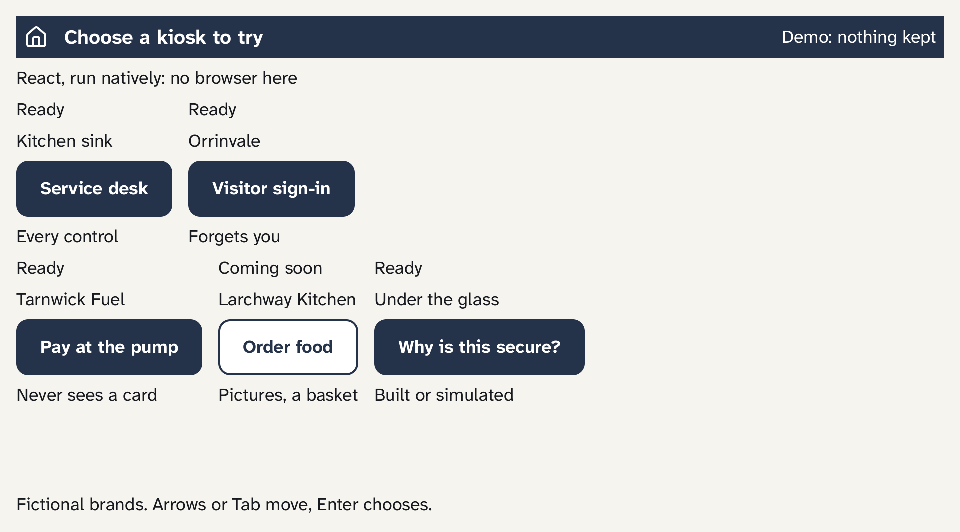

# NoWayOS Showcase

**Secure applications for public places, on NoWayOS.**

> No way to exploit what was never built in.

A self-service kiosk sits in public, often unattended, connected to systems
that matter, taking personal details from one stranger after another. Most
are an ordinary computer running a web browser, locked down with settings.

The Showcase builds kiosks the NoWayOS way instead: on NoWayOS, a
Single Purpose OS, with no browser, no desktop and nothing
installed beyond the application itself. It holds a kit for secure form
kiosks, a reference kiosk to build on, and a showcase of example kiosks that
runs on a Raspberry Pi.

Open source under MIT OR Apache-2.0, at your option ([Licence](#licence)).



## Why the Showcase

### More secure

- **No browser to attack.** Screens are native Rust drawn by NoWayOS's UI
  runtime; there is no browser, WebView or JavaScript on the device.
- **The screen holds no secrets.** The screen and the application run in
  separate sealed compartments: the screen sees only what a person does, and
  answers travel one way, from the screen to the application.
- **It forgets each person.** Kiosk forms can take sensitive details. Each
  person's answers are designed to stay only in the kiosk's memory and be
  wiped when the session ends, whether they finish, cancel or leave it idle
  for the set time. That wipe is built and tested in the kiosk's form
  handling; the complete kiosk is still being built.
- **It fails closed.** A record the application cannot decode ends the
  session, and late timers or a clock that goes backwards cannot postpone the
  wipe.

### More efficient

- **One job from power-on.** The device starts into the kiosk and runs
  nothing else.
- **Low-cost hardware.** The showcase runs on a Raspberry Pi 5 with an
  ordinary HDMI monitor, keyboard and mouse.
- **Only what changed is drawn.** Countdowns and updates repaint just the
  digits that change.

### Easier to work with

- **Screens designed in React.** Every kiosk screen is written in TSX and
  converted to Rust by the Screen Compiler, so designers keep their tools.
- **One kiosk flow for every form.** An application declares its steps and
  fields; the flow handles next, back and cancel, a review of every answer,
  checks as answers are entered, submission with a timeout and retries, the
  idle warning and the wipe.
- **Many examples, one base.** New kiosks reuse the flow, the screens' kit
  and the protection domains of the reference kiosk.

### Easier to prove

- **Privacy rules under test.** The kiosk flow's wipe, on idle, cancel, the
  session's limit and success, is covered by unit and property tests; every
  part that holds typed answers is being built to the same rule.
- **Fixed wiring.** Each system lists every connection between its
  compartments, checked by NoWayOS's grants checker at every build.

## The showcase

The Raspberry Pi boots to a launcher of example kiosks, each with a fictional
brand and invented details:

- **Service desk:** the reference kiosk's multi-step form.
- **Visitor sign-in:** a visitor book that forgets you; the pass shows a
  number, never a name.
- **Pay at the pump:** pump, fuel and amount, then the card reader; the
  screen never sees the card.

A product built on the Showcase may add one example of its own: the launcher
keeps a tile for it, hidden until a program fills it.

Home, or the end of a session however it ends, wipes the example and returns
to the launcher.

## Status

**Early, and not deployable.** The kiosk flow, its contract between screen
and application, the reference screens, the reference kiosk and the
showcase run in QEMU and on the Raspberry Pi 5's HDMI monitor with a USB
keyboard and mouse. Still to come: touchscreens, masking a PIN or
password on screen, storage, and a production kiosk.

## Try it

The Showcase builds against NoWayOS, at the commit `nowayos.rev` records, and
its screens with the Screen Compiler. The dev container mounts the folder
above the clones, so give the three a folder of their own:

```sh
mkdir nowayos-work && cd nowayos-work
git clone https://github.com/NoWayOS/nowayos.git
git clone https://github.com/NoWayOS/screen-compiler.git
git clone https://github.com/NoWayOS/showcase.git
git -C nowayos checkout "$(cat showcase/nowayos.rev)"   # the NoWayOS commit the Showcase is tested against
cd showcase
make -C ../nowayos container        # the dev image, once
make test                           # every crate's tests
make screens                        # convert every TSX screen with the Screen Compiler and check it
make qemu-test SYSTEM=kiosk         # boot the reference kiosk in QEMU and check it
make ci                             # the everyday gate
```

`make test` and `make ci` refuse a NoWayOS clone at any other commit, and say
which they found.

The showcase on the Pi 5, the layout and every target:
[DEVELOPING.md](DEVELOPING.md).

## Contributing

Start from an issue, sign off every commit, and pass the gates Defence Agent
writes down: [CONTRIBUTING.md](CONTRIBUTING.md). Instructions for AI
assistants: [AGENTS.md](AGENTS.md).

## Security

Please report vulnerabilities privately: [SECURITY.md](SECURITY.md).

## Part of NoWayOS

NoWayOS builds devices from only what their one job needs.
**[NoWayOS](https://github.com/NoWayOS/nowayos)** is its open
Single Purpose OS,
the **[Screen Compiler](https://github.com/NoWayOS/screen-compiler)** its open
build-time tool for React screens, and the **Showcase** shows what you can
build with them.
NoWayOS is sponsored by Adappt.ai.

## Licence

Licensed under either of [Apache License, Version 2.0](LICENSE-APACHE) or
[MIT licence](LICENSE-MIT), at your option. Every crate declares it, and every
source file carries an SPDX identifier.

Unless you explicitly state otherwise, any contribution intentionally submitted
for inclusion in this work by you, as defined in the Apache-2.0 licence, shall
be dual licensed as above, without any additional terms or conditions.
